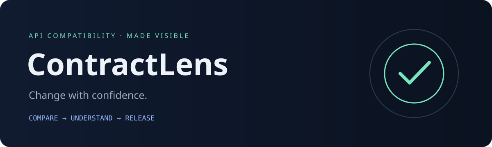

<div align="center">



**Catch breaking API changes before your users do.**

A small, dependency-free Python engine with a useful CLI, deterministic findings,
and a beautiful searchable report that works entirely offline.

[](https://github.com/adinax031-boop/ContractLens/actions/workflows/ci.yml)


</div>

## Try it in 30 seconds

```bash
git clone https://github.com/adinax031-boop/ContractLens.git
cd ContractLens
python -m contractlens examples/baseline.json examples/candidate.json
```

The sample intentionally contains breaking changes, so the command exits `1`.
Generate a shareable report without failing the shell:

```bash
python -m contractlens examples/baseline.json examples/candidate.json \
  --format html --output report.html --fail-on never
```

Open `report.html` in any modern browser. Search by endpoint or rule and filter
by severity. No server, login, analytics or network connection is required.
A pre-generated example is included at [`docs/demo.html`](docs/demo.html).

## What makes it useful

- **Directional compatibility:** request enums and response enums have opposite
  compatibility rules. Required fields and nullability are directional too.
- **Actionable evidence:** every finding includes severity, stable rule code,
  endpoint or schema location, and explanation.
- **Real reference handling:** local references, escaped JSON Pointer tokens,
  recursive schemas, inherited parameters and operation overrides.
- **CI integration:** predictable exit codes; text, JSON and HTML output;
  configurable failure policy.
- **Portable:** Python 3.10+, zero runtime dependencies, standard-library tests.
- **Honest scope:** uncertain changes receive review warnings. See the
  [compatibility model and limitations](docs/scope.md).

## Install the CLI

```bash
python -m pip install .
contractlens examples/baseline.json examples/candidate.json --format json
```

The package is installed from this repository; it is not published to PyPI.

## Use the engine

```python
import json
from pathlib import Path
from contractlens import compare

baseline = json.loads(Path("examples/baseline.json").read_text())
candidate = json.loads(Path("examples/candidate.json").read_text())
for finding in compare(baseline, candidate):
    print(finding.severity, finding.code, finding.location)
```

## Gate a release

```bash
contractlens api-baseline.json api-candidate.json \
  --fail-on warning --format json --output compatibility.json
```

Exit `0` passes the selected policy, `1` fails it, and `2` indicates an error.
Reports are generated even when compatibility checks fail. The supplied CI
runs the tests across Python 3.10–3.13 on Linux and Windows, builds the package,
and uploads a demo HTML report.

## Develop

```bash
python -m unittest discover -s tests -v
python -m compileall -q contractlens
```

Contributions should include behavioral tests for compatibility rules, especially
the request/response distinction. See [CONTRIBUTING.md](CONTRIBUTING.md).

**Scope:** OpenAPI 3.0 JSON subset. This is compatibility evidence, not a complete
validator or proof of release safety. Full coverage details are documented.

MIT licensed. Built for developers who want understandable API changes.
